<picture>
  <source media="(prefers-color-scheme: dark)" srcset="./assets/dark_mode.svg">
  
</picture>

</a>

---

### Currently

- **AI Engineer Intern @ ARTPARK, IISc** · sandboxed LLM agents, a Neo4j knowledge graph, and onboarding portals that took 700+ applications to a final 10
- **Research** · first-author paper under review at ECIR 2027 on where retrieval-augmented systems fail, built on India's 2024 criminal-law recodification
- **Building** · the evaluation harness behind [legal-mvp](https://github.com/uditauniyal/legal-mvp), and [GenomeSift](https://github.com/uditauniyal/GenomeSift) in C++17

*"I build AI agents for domains where being wrong isn't an option."*
